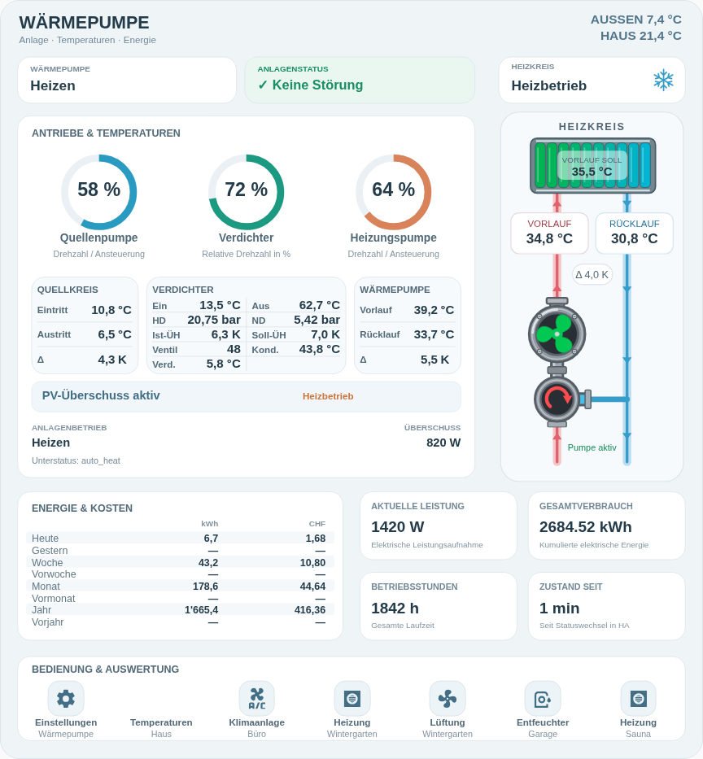

# Wärmepumpe und Heizkreis

Betrieb, Live-Messwerte, Heizkreis, Thermostate und Stromverbrauch der Wärmepumpe. Die Karte erscheint in HACS als **Dashboard**.



## Voraussetzungen

- **Button Card** für die Darstellung und Bedienung, geprüft mit Version 7.0.1. [custom-cards/button-card](https://github.com/custom-cards/button-card)
- **Browser Mod** für die Pop-ups, geprüft mit Version 3.4.2. Nach der Installation muss die Integration in Home Assistant eingerichtet sein. [thomasloven/hass-browser_mod](https://github.com/thomasloven/hass-browser_mod)
- **HUI Element** für die Heizkreissteuerung im Thermostate-Pop-up. [thomasloven/lovelace-hui-element](https://github.com/thomasloven/lovelace-hui-element)
- **KeEnergy-Heizkurven-Karte** (`custom:keba-keenergy-heizkurve-card`) nur für das optionale Heizkurven-Pop-up. Lade ihre eigene Dashboard-Ressource.

Die Karte verwendet bereits vorhandene Home-Assistant-Entitäten. Übersicht und Messwerte werden im Dashboard angezeigt, sobald die Entitäten zugeordnet sind.

## Über HACS installieren

1. Suche in HACS nach **Wärmepumpe und Heizkreis**. Falls die Karte noch nicht angezeigt wird, öffne **HACS → ⋮ → Benutzerdefinierte Repositorys**, füge `https://github.com/marcofeurer/waermepumpe-dashboard-card` hinzu und wähle die Kategorie **Dashboard**.
2. Öffne die Karte in HACS und wähle **Herunterladen**. Lade das Dashboard anschließend neu.
3. Öffne **Dashboard bearbeiten → Karte hinzufügen** und wähle **Wärmepumpe und Heizkreis**.

## Entitäten visuell zuordnen

Öffne **Dashboard bearbeiten → Karte bearbeiten** und klappe die gewünschte Gruppe auf. Die Entitäten sind in **Wärmepumpe**, **Heizkreis**, **Energie und Stromtarif**, **Haus- und Aussentemperatur**, **Thermostate und Ferienmodus** und **Geräte** gegliedert.

Suche in den Feldern nach Anzeigenamen oder Entitäts-ID. Bereits gespeicherte Zuordnungen erscheinen im Editor. Wenn du ein Feld leerst, verwendet die Karte dort wieder ihre Platzhalter-ID. Du kannst dieselben Zuordnungen auch im YAML-Editor bearbeiten. [Beispielkonfiguration](example.yaml)

Die Vorlage verwendet Betriebszustände und Sensoren von KEBA KeEnergy. Die Verbrauchs- und Tarifwerte kommen aus den unter `energie` zugeordneten Entitäten. Die Anzeige der Kosten übernimmt das Währungsformat CHF aus der Vorlage.

## Optionale Pop-ups

Ergänze die folgenden Schlüssel auf derselben YAML-Ebene wie `entitaeten`.

```yaml
grafana_url: https://grafana.example.org/d/temperaturen-haus
heizkurve:
  auto_lock_minutes: 10
```

- `grafana_url` blendet die Schaltfläche **Temperaturen Haus** ein. Verwende die vollständige URL eines Grafana-Dashboards, das die Einbettung in Home Assistant erlaubt.
- `heizkurve` blendet die Schaltfläche für die separate KeEnergy-Heizkurven-Karte ein. Die Optionen werden an diese Karte weitergegeben. Setze `edit_password_hash` bei Bedarf in deiner lokalen Kartenkonfiguration.

## Fehlersuche

Wenn Home Assistant meldet, dass der Kartentyp fehlt, lade die Seite neu und prüfe unter **Einstellungen → Dashboards → ⋮ → Ressourcen**, ob `/hacsfiles/waermepumpe-dashboard-card/waermepumpe-dashboard-card.js` als **JavaScript-Modul** eingetragen ist. Bei YAML-verwalteten Dashboard-Ressourcen ergänze die URL in deiner YAML-Ressourcenliste.

[HACS-Dokumentation für Dashboard-Repositorys](https://www.hacs.xyz/docs/publish/plugin/) · [Benutzerdefinierte Repositorys](https://www.hacs.xyz/docs/faq/custom_repositories/)

## Lizenz

Die Karte steht unter der [MIT-Lizenz](LICENSE).
